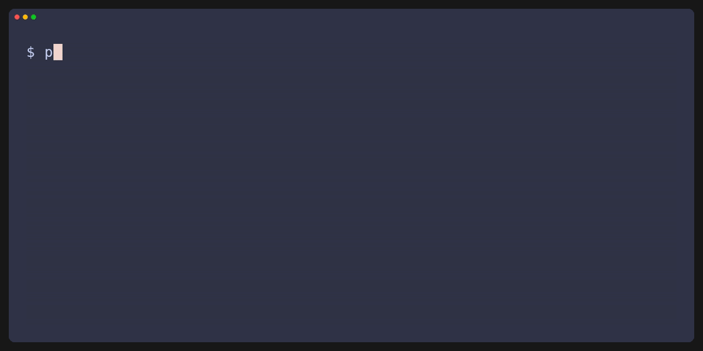
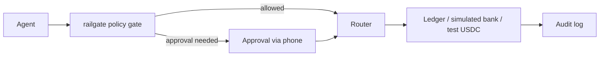
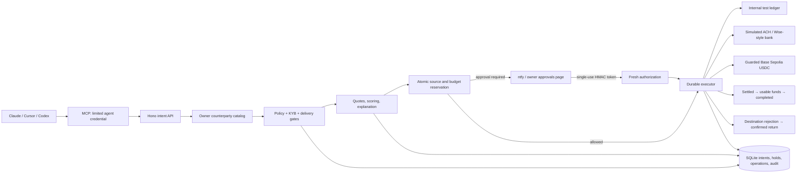

# railgate

Spending limits, human approvals and smart rail routing for AI agent payments. Open source, test money only.



The GIF uses an in-memory test ledger and simulated approval/notifications. It makes no external calls. [MP4](docs/media/railgate-offline.mp4) · [Reproduce the recording](examples/overspend-demo/README.md#record-the-terminal-demo)



## What it does

- Enforces owner spending limits and recipient rules before funds move; larger payments need human approval.
- Compares eligible rails, fees and delivery times, then explains the selected route and rejected alternatives.
- Persists payment state, reservations and signed testnet transactions so retries reuse the original payment.
- Offers MCP tools and an HTTP API, with an append-only audit log and explicit test/simulation labels.

## Quickstart

Use Node **20.19+, 22.13+ or 24** and **pnpm 10.20.0**. No wallet, faucet or provider credentials are needed for this offline demo.

```sh
pnpm install
pnpm test
pnpm demo:offline
```

[Full documentation](#full-documentation) · [Contributing](CONTRIBUTING.md) · [Roadmap](ROADMAP.md)

## Full documentation

### Architecture

railgate is an open-source payment layer for AI agents, inspired by [Stablecoins at Natural](https://faizan.sh/stablecoins-at-natural). An agent describes a payment; deterministic owner rules and human approvals control spending, a router chooses how to deliver the requested funds, and an append-only log records the result. It supports a common lifecycle across an internal test ledger, simulated banking and real **Base Sepolia test USDC**. **Test money only.**

This recording runs the actual policy/router/lifecycle against an in-memory test ledger. Owner approval and notifications are simulated; it makes no external calls or chain transfers. [MP4 video](docs/media/railgate-offline.mp4) · [Recording instructions and VHS tape](examples/overspend-demo/README.md#record-the-terminal-demo)



### Five-minute local quickstart

Use **Node 20.19+, 22.13+ or 24** and **pnpm 10.20.0**. Install that pnpm version with Corepack or `npm install --global pnpm@10.20.0`. From the checkout:

```sh
pnpm install --frozen-lockfile
pnpm test
pnpm demo:offline
pnpm demo:quotes
pnpm demo:routing
pnpm lint
pnpm typecheck
pnpm build
```

The offline overspend demo exercises the actual lifecycle with an in-memory test ledger and a mock notifier: $5 completes, $45 requires approval, a cumulative $150 attempt is denied, and retrying creates no second debit. It makes no external calls. Quote/routing demos label simulated prices and use fictional profiles. The routing demo sends the **identical hypothetical 250,000 MXN intent** through USDC Monday after cutoff and a cheaper bank quote Tuesday morning; neither plan executes a payment.

Tests use real SQLite, Hono, official MCP clients (including stdio) and local HTTP/RPC fixtures. External chains, notifications and Wise responses are mocked. CI runs lint, typecheck, tests, build and all offline demos on Node 20, 22 and 24.

### Run the testnet service

1. Run `pnpm init:local`. It preserves an existing `.env`; otherwise it generates dedicated test-only payer/merchant wallets, independent owner/agent/HMAC credentials and a random ntfy topic in a git-ignored **mode 0600** file. It prints only the payer's public address. `.env.example` contains placeholders.
2. Fund the payer with **at least 55 test USDC** for the $5 + $45 approve path, and **Base Sepolia ETH** for gas. Use [Circle's faucet](https://faucet.circle.com/) with **Base Sepolia** selected and the [Base faucet directory](https://docs.base.org/base-chain/tools/network-faucets). Faucet quotas can take longer than five minutes. A full routing quote reserves its all-in modeled USD cost; exactly 50 test USDC may be insufficient for both payments plus fee allowances.
3. Install [ntfy](https://ntfy.sh/) and subscribe to the private `NTFY_SERVER` / `NTFY_TOPIC` from `.env`. An authenticated topic can additionally use `NTFY_TOKEN`. Topic names and approval URLs are secrets.
4. Set `PUBLIC_BASE_URL` to an actual public HTTPS origin forwarding to this service on port 3000, reachable from the owner's phone. Redact query-string access logs: approval links contain capabilities. Keep the default loopback bind behind your proxy.
5. Start `pnpm dev` (or `pnpm build` then `pnpm start`). In another terminal run `pnpm demo`. Keep **`DEMO_RUN_ID` unchanged on retries**. The script waits for the human to approve/reject $45; it never approves for the owner. New requests pass through the common asynchronous lifecycle, so a POST acknowledgement may initially say `created`.

Startup validates the actual RPC chain ID **84532** and fixed Circle test USDC contract before accepting requests. Chain checks repeat before signing, broadcasting and receipt reads. Other networks, including mainnets, are refused. There is no mainnet mode. `HTTPS_PROXY`, `HTTP_PROXY` and `NO_PROXY` are honored with loopback kept local and TLS verification enabled.

The CLI binds the configured payer's catalog wallet to the signing wallet and DataCo's wallet to `DEMO_RECIPIENT_ADDRESS`. Other recipient wallets/accounts come from the owner-maintained `COUNTERPARTY_PATH`, defaulting to [examples/counterparties.json](examples/counterparties.json). Its bank references and KYB flags are explicitly fictional test data. Agents cannot edit the catalog.

Owner pages `/approvals` and `/dashboard` require Basic username **`owner`**, password **`OWNER_API_TOKEN`**. `/approvals` provides Approve/Reject when a push is missed. The dashboard is read-only and shows decisions, reasons, hashes and audit events. `/owner/audit` accepts owner authentication; `/health` is public. Serve these routes over HTTPS. Run one payment daemon per database/signing wallet; do not run another process using that wallet's nonce or mutate payment state manually.

### Connect Claude Desktop, Cursor or Codex

Start the HTTP daemon and run `pnpm build`. Add this server to Claude Desktop's MCP configuration, Cursor's `.cursor/mcp.json`, or the equivalent Codex MCP configuration:

```json
{
  "mcpServers": {
    "railgate": {
      "command": "node",
      "args": ["/absolute/path/to/railgate/dist/src/cli.js", "mcp"],
      "env": {
        "RAILGATE_API_URL": "http://127.0.0.1:3000",
        "RAILGATE_AGENT_TOKEN": "same-as-AGENT_API_TOKEN-from-private-env"
      }
    }
  }
}
```

The stdio process **does not load `.env`**. Supply only the limited agent credential and API origin. Keep wallet keys, HMAC material and owner credentials out of its environment. Remote APIs require HTTPS; HTTP is allowed only on loopback.

To configure local clients automatically after building, run `pnpm setup:mcp` from the owner terminal. It creates a private, ignored `.env.mcp` with only the agent token/API origin, plus local Codex and Cursor configuration files. Existing client files are preserved. Register with Codex using `codex mcp add railgate -- node /absolute/path/to/railgate/scripts/mcp-launch.mjs`, then reload the client. The launcher opens only `.env.mcp` and removes owner/wallet/unrelated credentials from its child process environment. For the hosted API use `pnpm setup:mcp --api-url https://your-project.vercel.app`. Claude Desktop can use the launcher entry printed by setup.

| MCP tool | HTTP equivalent | Effect |
| --- | --- | --- |
| `request_payment` | `POST /api/payments` | Create/retry an idempotent payment |
| `fetch_paid_resource` | `POST /api/paid-resources` | Fetch an owner-allowed x402 resource; same key reuses one authorization |
| `get_payment_status` | `GET /api/payments/:id` | Read this payer's logical status |
| `list_payments` | `GET /api/payments?limit=100` | List this payer's payments |
| `get_my_limits` | `GET /api/limits` | Read owner limits and daily allowance |
| `quote_payment` | `POST /api/quotes` | Read normalized estimates |
| `plan_payment` | `POST /api/routes` | Persist a read-only route explanation |

`GET /api/routes/:id` retrieves the payer's stored plan. HTTP agent routes require the agent bearer token. There is no MCP tool for policy changes, approval, returns or rail selection.

A full payment intent says **what the recipient receives**:

```json
{
  "idempotency_key": "invoice-dataco-001",
  "payer": "research-agent-07",
  "recipient": "dataco",
  "amount": "5.00",
  "destination_currency": "USD",
  "deadline": "2026-11-06T23:00:00Z",
  "purpose": "dataset access",
  "max_fee": "1.00",
  "reversibility_requirement": "none",
  "recipient_preferences": { "delivery": "internal", "avoid_stablecoins": false },
  "metadata": { "invoice_id": "001" }
}
```

Use a future deadline when running this example. Amounts and `max_fee` are decimal strings with at most two places; supported destination currencies are USD, MXN and EUR. `max_fee` and policy budgets are **USD**. Delivery can be `any`, `internal`, `bank` or `wallet`; reversibility can be `none`, `preferred` or `required`. The payer must match the authenticated agent. No rail field is accepted.

Identical normalized requests reuse their original ID/result. A changed payload with the same payer/key returns **409**, including changing a deadline or metadata. A returned/rejected/failed key remains consumed. To retry an uncertain network response, send the original intent and key; never create a replacement payment.

Legacy USD wallet requests with an inline `{id,name,address,category}` recipient are supported through the same gates, with the address required to match the owner catalog. Historical M1 fingerprints/IDs/hashes remain valid. Full intents are preferred for new integrations. Quote and plan requests alone never reserve funds or execute a payment.

### Rails, quotes and routing

| Rail | Execution | Pricing / availability |
| --- | --- | --- |
| `ledger` | Atomic internal **test** accounts | Instant, free; both parties need internal accounts |
| `ach-mock` | **Simulated** US/USD bank transfers and returns | 16:00 New York cutoff; US banking holidays/weekends; 1–2 business days |
| `usdc-base-sepolia` | Real test USDC on chain **84532** | Modeled onramp, gas, FX and offramp fees; bank-form payout is simulated |
| `wise-quote` without credentials | **Mock** Wise-style bank execution/returns | Explicitly modeled FX, fees and bank timing |
| `wise-quote` with sandbox credentials | Verified sandbox **quotes only** | No transfer creation/funding; ineligible for execution |

Optional `WISE_SANDBOX_TOKEN` + `WISE_SANDBOX_PROFILE_ID` use the documented [2026Q4 sandbox quote API](https://docs.wise.com/api-reference/quote/quotecreate) on `api.wise-sandbox.com`. Inclusive `sourceAmount` and `price.total.value.amount` normalize total cost without double-counting fees. Undisclosed FX spread is not invented. A configured provider error is unavailable, never silently replaced with mock pricing. Live sandbox calls remain unverified without credentials.

Quotes reconcile principal, all-in USD cost, fee/step totals, expected/latest usable-funds time, certainty, reversibility and pricing/execution labels. Fixed test FX assumptions are **17 MXN/USD** and **0.92 EUR/USD**, not market rates. Ledger and mock bank sources each seed $100 fictional money once per configured source/database; restarting preserves balances. The test FX treasury supplies only modeled payouts. USDC liquidity uses the real testnet wallet balance. Modeled USD fees are policy/accounting allowances, not actual fiat charges.

Identity, category, owner expiry and simulated KYB pass **before providers are called**. Every quote then passes recipient/corridor, policy budgets, amount/liquidity, deadline, max fee, FX, health, operating window and reversibility gates **before scoring**. Owner `routing` settings choose `lowest_cost`, `fastest` or `refund_certainty`, allowed rails, blocked countries and minimum certainty. Plans store alternatives, rejection reasons and a policy hash. [policies/corporate.example.yaml](policies/corporate.example.yaml) supplies a separate fictional high-value budget for the 250,000 MXN demo; it never replaces the server's $100 limits.

### Lifecycle, fallback and returns

```text
created → recipient_resolved → route_selected → funds_reserved
                                              ↓ approval if required
          in_transit → settled → completed
               ↘ failed          ↘ returned (only after confirmed source credit)
```

The API exposes common logical status, approval/denial outcomes and a safe summary, without raw signed transactions or provider states. Instant ledger stages may occur within one worker tick; the audit retains each transition. `settled` is distinct from `completed`: a confirmed chain transaction delivering a modeled bank payout remains `settled` until the requested bank funds are usable. Bank holidays/cutoffs still apply.

Source holds and daily reservations are atomic. Approval rechecks policy, beneficiary and deadline before execution. Quotes expire after five minutes in the model; a pending approval lasts 15 minutes. Expired quotes are refreshed within the approved source-cost cap; a more expensive replacement fails clearly. A changed recipient profile requires a new reviewed intent. UTC rollover rechecks the execution day's budget.

Automatic fallback requires proof that no funds may have left, no irreversible transfer, no FX exposure and no charged fees. A replacement must preserve amount/currency/form, pass fresh gates and fit any human-approved cap. Unknown results retain the original operation and accounting. Signed USDC bytes/hash are durable before broadcast; timeouts and restarts replay those bytes only. Interrupted signing is quarantined and blocks further signing until the owner investigates.

A rejected simulated bank destination returns principal to the original payer and retains quoted fees. Only confirmed source credit produces `returned`. The owner can request a return with `POST /owner/payments/:id/return`, owner authentication and an empty JSON object. The dashboard remains read-only. USDC generally needs recipient cooperation: an optional matching `DEMO_RECIPIENT_PRIVATE_KEY` enables the dedicated test recipient to sign a return, and that recipient also needs test ETH for gas. Missing cooperation, insufficient gas, an unknown outcome or a reverted transaction never produces a fabricated refund. A real cooperative return was not exercised in this instance.

### Standalone payroute library and playground

The routing engine is also an independent [payroute workspace package](packages/payroute/README.md). It has no railgate server, SQLite or MCP dependency. Railgate imports its core planner, schemas and adapters through compatibility exports, preserving the existing routing tests unchanged.

Try [the routing playground](https://railgate-self.vercel.app/playground/) after deploying this revision, or run `pnpm dev:playground` locally. Enter amount, currencies, deadline, delivery preferences and send time to see normalized quotes, the chosen rail and every rejection reason. Presets cover domestic payments, Monday/Tuesday MXN timing, refunds, weekends and holidays. It runs the actual library entirely in the browser with fictional profiles and modeled/mock pricing; it cannot approve or execute payments.

`pnpm build:playground` builds the static page and stages it under `public/playground/` for the existing Vercel site. The package also includes Vercel/Netlify configs for independent hosting. Its README covers the typed `createRouter({ rails, scoring, context })` API, custom adapters/scoring, standalone installation and test boundaries. `payroute` returned 404 on the public npm registry on 2026-10-27; version 0.1.0 is prepared for the maintainer to publish. After publication, install with `npm i payroute`.

### x402 paid HTTP resources

Run `pnpm demo:x402` with no credentials: fetch a $0.01 weather resource, deny a $5 request against a $1 ceiling, then retry the first request with exactly one payment. It uses the official x402 **2.28.0** client, EVM scheme and Hono merchant middleware with real EIP-712 signatures. The default fixture's chain/facilitator is **mocked**, and its hashes are not blockchain receipts. See [fixture setup](examples/x402-server/README.md) and the [optional real x402 testnet guide](docs/x402-testnet.md).

The MCP tool `fetch_paid_resource(url, max_price, purpose, idempotency_key?)` maps to authenticated `POST /api/paid-resources`; poll `GET /api/paid-resources/:id` after an owner approval. Example body:

```json
{"url":"https://api.example.com/weather","max_price":"1.00","purpose":"weather lookup","idempotency_key":"weather-2026-10-26"}
```

`max_price` is a ceiling in USD, not an offered price. The server's `PAYMENT-REQUIRED` header determines the exact atomic USDC amount. Sub-cent prices round **up** for conservative policy accounting; the signed transfer retains the exact server amount. Results contain bounded text/JSON data plus an independently confirmed receipt, never signatures or approval tokens. Free 2xx resources require no payment.

Paid fetching is **disabled until the owner configures `x402`** in the existing owner policy. Merge [the example block](policies/x402.example.yaml), replacing its placeholder hostname with trusted public HTTPS merchants. Configure per-request/daily API caps, exact hostnames and owner-assigned categories (`data`, `inference`, `compute`). API reservations also count against the existing $100/payment, $100/day shared caps and shared USDC wallet holds. The existing approval threshold applies; approval expires after 15 minutes and releases unspent reservations. Agents cannot edit policy or approve themselves.

Only x402 v2 `exact` EIP-3009 on **Base Sepolia (`eip155:84532`)**, fixed Circle test USDC, is enabled. Actual RPC chain/contract checks run before signing and sending. Real receipts require two L2 confirmations, matching token transfer logs and a transaction matching the persisted authorization nonce. This verifier currently accepts direct token `transferWithAuthorization` settlement; batched/smart-wallet settlement, Permit2, `upto`, mainnet and other tokens are unsupported and fail closed.

Requirements and the exact signed authorization are saved before HTTP delivery (SQLite `synchronous=FULL` locally, `storage.sync()` on the durable worker). Completed retries return cached data/receipt; ambiguous delivery replays the **same** EIP-3009 nonce/header only when the original request is retried. It never signs a replacement. A merchant without durable response recovery may fail to deliver content after settlement; the request remains uncertain with funds reserved for owner reconciliation. Keep the same explicit key; omitting it means one logical purchase per agent and URL. Changing a request under an existing key returns 409.

The fetcher accepts GET text/JSON responses up to 256 KiB, refuses redirects, URL credentials and private IP literals, and forwards no cookies or authorization. Explicit trusted-host allowlisting is the network boundary; this is not a general-purpose DNS-pinned web proxy. Resource content is untrusted data. No additional secret is needed for x402 beyond the existing owner-controlled test wallet/RPC. The live deployment has not made an x402 transfer as part of these tests.

Official references verified before implementation: [buyer](https://docs.x402.org/getting-started/quickstart-for-buyers), [seller](https://docs.x402.org/getting-started/quickstart-for-sellers), [exact scheme](https://docs.x402.org/schemes/exact), [canonical SDK source](https://github.com/x402-foundation/x402/tree/main/typescript).

### Owner policy

[policies/example.yaml](policies/example.yaml) has a hard **$100/payment**, **$100/day**, and approval **strictly above $20**. All-in source cost includes modeled fees. `new_merchant_max: 5.10` permits the first $5 wallet demo plus its modeled $0.03 fee allowance; it is an inclusive hard ceiling, not an approval override.

- `max_per_payment`, `max_per_day`: inclusive USD hard ceilings, integer cents.
- `require_approval_above`: amounts greater than this require a human.
- `new_merchant_max`: hard ceiling until this merchant **and owner destination** have successful history. Wallet/bank/internal destinations do not inherit each other's trust.
- `allowed_merchants`: IDs, optional allowed categories and optional destination address pin. Category information comes from the owner catalog. Unknown merchants fail.
- `expires_at`: UTC ISO timestamp; denied at/after expiry.
- Optional `routing`: strategy, `allowed_rails`, `blocked_countries`, `min_certainty`. See the corporate example.

The owner file reloads on evaluation; invalid rules fail closed. Daily accounting uses **UTC** and the day funds were committed for execution. Reserved/unknown outcomes retain budget; rejection/expiry releases it. Confirmed returns retain nonrefundable fees against the original execution day. Approval never overrides hard policy, compliance or delivery constraints.

### Security and limits

- Approval URLs use HMAC-SHA256, a random single-use nonce and 15-minute expiry. One decision consumes both actions; replay/forgery/expiry fail. **GET never approves**. ntfy uses its [documented JSON publish API](https://docs.ntfy.sh/publish/#using-a-json-array) behind a `Notifier` interface; its POST buttons and owner web page provide the two paths.
- The fixed token is Circle's [Base Sepolia test USDC](https://developers.circle.com/stablecoins/usdc-contract-addresses). No live bank, Wise transfer, mainnet, live FX or actual fiat on/off-ramp path exists. Fictional KYB flags are not a real compliance service.
- Audit/journal tables block UPDATE/DELETE with SQLite triggers. This records intent, authenticated actor, decisions, explanation, approval identity, timestamps and hashes. A filesystem/database owner can still alter storage; it is not externally tamper-proof.
- Isolate `.env`, wallet, policy, catalog and database files from the agent. An agent with owner filesystem access has owner privileges. Owner HTML escapes agent content and disables scripts, framing, caching and referrer leakage.
- Never publish keys, topics, approval URLs, signed bytes or private database backups. Preserve the database during recovery; do not delete reservations or reuse a signing wallet outside this daemon to force a retry. Two L2 confirmations are not Ethereum finality.

### Milestones and evidence

1. Deterministic policy, ntfy approvals, MCP and test USDC: **implemented**. A real $5 transfer, owner rejection of $45, overspend denials and unchanged retry hash passed. [M1 evidence](docs/milestone-1.md) distinguishes ntfy API acceptance from unconfirmed native-app delivery.
2. Full intents, profiles and normalized quotes: **implemented**. [M2](docs/milestone-2.md).
3. Gates before scoring, persisted explanations and Monday/Tuesday routing: **implemented**, with policy/router tests written first. [M3](docs/milestone-3.md).
4. Common execution, safe fallback, usable-funds completion and returns: **implemented**. [M4](docs/milestone-4.md). Automated native returns use a mock transport; no additional live spend was performed.
5. Quickstart, architecture, recording guide, read-only dashboard, MIT license and CI: **implemented**. [Record the overspend clip](examples/overspend-demo/README.md).

Milestones were tested and committed in order. Current-instance checks do not establish remote CI execution, cloud publication or restoration in a fresh task.

### Free Vercel + persistent Cloudflare hosting

The free hosting path uses the existing Vercel gateway plus a **Cloudflare Workers Free** backend: one SQLite-backed Durable Object stores payment history and native alarms resume execution without an always-running server. See [the free deployment guide](docs/deployment-free.md). The Vercel project receives only `RAILGATE_BACKEND_ORIGIN`; wallet/owner/ntfy secrets stay on the backend. Cloudflare's free quotas are finite: exceeding them produces errors and requires waiting for reset or reducing usage. This setup never enables a paid plan automatically.

Use Node **22+** for Wrangler/Miniflare worker tooling (Node 24 recommended). The Node CLI/core test workflow remains supported on Node 20.19+. Run `pnpm build:worker` and `pnpm test:worker` for the production bundle and actual workerd/SQLite integration tests. The optional [Render/Docker deployment](docs/deployment.md) requires paid persistent storage and is not used for the selected free setup.
