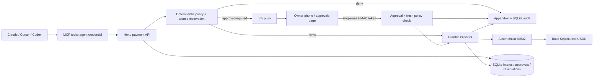

# railgate

railgate is an open-source payment layer for AI agents: an agent requests a payment, deterministic owner rules decide whether it is allowed, a human approves when required, and every step is recorded. Inspired by [Stablecoins at Natural](https://faizan.sh/stablecoins-at-natural), the goal is for agents to say what they want to pay while railgate decides how money moves. **The current version supports policy-controlled test USDC payments and normalized multi-rail quotes. Route selection and the common multi-rail execution lifecycle are subsequent milestones. Test money only.**



## 5-minute quickstart

Use Node **20.19+** (Node 22.13+ or Node 24 also supported) and **pnpm 10.20.0**. Install that pnpm version with Corepack or `npm install --global pnpm@10.20.0` if needed. Commands run from the repository root.

```sh
pnpm install --frozen-lockfile
pnpm test
pnpm demo:offline
```

The offline demo explicitly mocks chain execution and ntfy. It proves the local policy/approval/idempotency workflow: `$5` is allowed, `$45` awaits approval, a cumulative `$150` attempt is denied, and retrying the first request creates no second transfer. It does **not** prove phone delivery or live testnet execution.

```sh
pnpm lint
pnpm typecheck
pnpm build
```

CI runs these checks and the offline demo on Node 20, 22 and 24. The tests need no keys, notifications or external RPC calls.

## Run with real Base Sepolia test USDC

1. Run `pnpm init:local`. It creates a **git-ignored, mode 0600 `.env`** with two fresh testnet wallets, independent owner/agent/HMAC secrets, and a random ntfy topic. It prints only the payer's public address and preserves an existing `.env`. `.env.example` contains placeholders only. Never reuse a funded mainnet private key.
2. Fund the generated payer with **at least 50 test USDC** for the approve path and some **Base Sepolia ETH** for gas. Get test USDC at [Circle's faucet](https://faucet.circle.com/), selecting **Base Sepolia**, and use the [Base testnet faucet directory](https://docs.base.org/base-chain/tools/network-faucets) for gas. Faucet quotas or access requirements may make this take longer than five minutes. The merchant address and its test-only recovery key are also in `.env`.
3. Install the [ntfy app](https://ntfy.sh/), then subscribe to `NTFY_SERVER` / `NTFY_TOPIC` from your private `.env`. A random topic is a bearer secret; protect subscription access. For authenticated private topics, set `NTFY_TOKEN` too. Do not share the topic, approval links, `.env`, or dashboard credentials in a recording.
4. Put an HTTPS reverse proxy in front of the loopback service on port 3000. Set **`PUBLIC_BASE_URL` to that public HTTPS origin**, reachable from your phone. Forward the paths unchanged; disable or redact query-string access logging because approval URLs contain secrets. The app binds `127.0.0.1` by default. A loopback URL cannot receive a phone's approval callback.
5. Run the service and live demo in two terminals:

   ```sh
   pnpm dev
   # In the other terminal:
   pnpm demo
   ```

Startup checks the actual RPC chain ID and fixed test USDC contract **before accepting requests**. Any chain other than `84532` is rejected, including mainnets and other testnets. The RPC is checked again before preparation, broadcasting and receipt checks. TLS verification stays enabled. The service honors `HTTPS_PROXY`, `HTTP_PROXY` and `NO_PROXY` through Undici, with loopback traffic kept local.

The live demo uses `DEMO_RECIPIENT_ADDRESS`, `DEMO_RUN_ID`, and the agent credential from `.env`. **Keep `DEMO_RUN_ID` unchanged for retries**; changing it creates new intents. After `$5` completes, approve or reject `$45` on your phone within 15 minutes. Approving makes the subsequent `$100` request a cumulative `$150` attempt. Rejecting also leaves insufficient daily allowance for that request. An ambiguous network result keeps the original reservation and transaction hash. Do not delete the database or create a replacement intent to work around it.

Owner pages: `/approvals` lists pending actions; `/dashboard` shows recent payments, decisions, transaction hashes and audit records. Both require HTTP Basic authentication: username **`owner`**, password **`OWNER_API_TOKEN`**. Protect the public endpoint with HTTPS. The dashboard has no payment or policy editing controls. `/owner/audit` also accepts the owner bearer token. `/health` is public and contains no secrets.

## Connect Claude Desktop or Cursor over MCP

Start the HTTP service first and run `pnpm build`. Add this to Claude Desktop's MCP configuration or Cursor's `.cursor/mcp.json`, replacing the path and the placeholder **locally**:

```json
{
  "mcpServers": {
    "railgate": {
      "command": "node",
      "args": ["/absolute/path/to/railgate/dist/src/cli.js", "mcp"],
      "env": {
        "RAILGATE_API_URL": "http://127.0.0.1:3000",
        "RAILGATE_AGENT_TOKEN": "same-as-AGENT_API_TOKEN-from-private-env"
      }
    }
  }
}
```

The stdio MCP process deliberately **does not load `.env`**. Give it only the limited agent token and API origin. Keep owner credentials, HMAC material and wallet keys out of the agent's MCP environment. A remote MCP API must use HTTPS; HTTP is permitted only for loopback.

Tools: `request_payment`, `get_payment_status`, `list_payments`, `get_my_limits`, and read-only `quote_payment`. No tool can edit policy, approve a payment, select a rail, or bypass evaluation. A USD-only payment request looks like:

```json
{
  "idempotency_key": "invoice-dataco-001",
  "payer": "research-agent-07",
  "recipient": {
    "id": "dataco",
    "name": "DataCo",
    "address": "YOUR_BASE_SEPOLIA_MERCHANT_ADDRESS",
    "category": "data"
  },
  "amount": "5.00",
  "purpose": "dataset access",
  "metadata": { "invoice_id": "001" }
}
```

Amounts are positive USD decimal **strings**, at most two decimal places. This milestone pays the same nominal amount in test USDC; it makes no live FX or USD redemption claim. The payer must match the authenticated `AGENT_ID`. An identical normalized intent with the same payer/idempotency key returns the existing payment. Reusing a key for a different payload returns HTTP 409.

The authenticated HTTP API mirrors these tools: `POST /api/payments`, `GET /api/payments/:id`, `GET /api/payments?limit=100`, `GET /api/limits`. Use the **agent** bearer token. Agents cannot read other payers' payments, the owner audit endpoint, or pending approval capabilities.

## Multi-rail quote model

Run `pnpm demo:quotes` for a credential-free demonstration of comparable quotes for DataCo and **Norte Manufacturing** (Mexico, MXN bank preference, also accepts a Base Sepolia wallet). The owner catalog is [examples/counterparties.json](examples/counterparties.json); these are explicitly fictional test profiles, test bank references and simulated KYB statuses. Set `COUNTERPARTY_PATH` to another owner-controlled catalog. The API/MCP cannot edit it.

`quote_payment` and `POST /api/quotes` accept the full destination-denominated intent:

```json
{
  "idempotency_key": "norte-invoice-001",
  "payer": "research-agent-07",
  "recipient": "norte",
  "amount": "250000",
  "destination_currency": "MXN",
  "deadline": "2026-11-06T23:00:00Z",
  "purpose": "manufacturing invoice",
  "max_fee": "1000",
  "reversibility_requirement": "none",
  "recipient_preferences": { "delivery": "bank", "avoid_stablecoins": false },
  "metadata": { "invoice_id": "001" }
}
```

Amount is what the recipient should receive in `destination_currency` (currently USD, MXN, EUR). `max_fee` is a USD decimal string. The payer funds in USD in this prototype. There is no rail field. Quotes contain all-in USD cost, reconciled fee/step breakdowns, expected/latest time until the requested form is usable, certainty, reversibility and explicit pricing/execution labels. Quotes alone do not authorize, reserve or execute a payment.

- **ledger:** instant/free between internal test accounts in the supported currency.
- **ach-mock:** explicitly simulated US/USD banking. 16:00 New York cutoff, US banking holidays, weekends and 1–2 banking-day settlement. It cannot directly pay MXN to Mexico.
- **usdc-base-sepolia:** testnet transfer leg with modeled onramp, gas, FX and offramp pricing. Bank-form availability includes payout waiting time; no live onramp/offramp or real bank payout is claimed.
- **wise-quote:** labelled mock by default. Optional `WISE_SANDBOX_TOKEN` and `WISE_SANDBOX_PROFILE_ID` enable the documented [2026Q4 sandbox quote API](https://docs.wise.com/api-reference/quote/quotecreate) at `api.wise-sandbox.com`. Its inclusive source amount and `price.total.value.amount` drive the normalized total; separately undisclosed FX spread is not invented. A configured sandbox error is reported as unavailable, never silently relabelled a mock. This adapter creates quotes only, never Wise transfers.

Model rates are explicitly fixed test assumptions (17 MXN/USD and 0.92 EUR/USD), not market rates. All new adapters share `quote`, `execute`, `status`, `reverse` signatures; multi-rail execution methods remain blocked until the lifecycle milestone wires them safely. The existing USD-only payment API retains its persisted idempotency keys and real test USDC execution path.

## Policy format and semantics

See [policies/example.yaml](policies/example.yaml). The agreed demo policy has a hard `$100` per-payment ceiling, `$100` daily ceiling and approval **strictly above `$20`**. Approval cannot override either hard ceiling. The new-merchant ceiling is `$5` so the first `$5` demonstration establishes real successful history; lower it to `$2` if that is your preference.

- `max_per_payment`, `max_per_day`: inclusive hard ceilings, enforced in integer cents.
- `require_approval_above`: inclusive automatic-payment limit; greater amounts require approval.
- `new_merchant_max`: inclusive hard ceiling for an allowed merchant **and destination address** with no successful payment history. Reusing a merchant ID with a new wallet does not inherit trust.
- `allowed_merchants`: owner allowlist of IDs, optional `categories`, optional pinned `address`. Add a pinned address if the agent must never choose another wallet for that merchant. An absent category fails a category-constrained rule. Unknown merchants are denied.
- `expires_at`: UTC ISO timestamp; payments are denied at or after that instant.

Policies reload on each evaluation, so owner edits take effect without giving agents an editing API. Invalid policy files fail closed. The daily period is **00:00–24:00 UTC**, across the owner's database. Pending approvals, queued transfers, submissions and uncertain outcomes reserve budget. Expired/rejected/denied requests release it. Completed payments retain it for their execution day. Historical success is required before a merchant gains the higher allowance.

The policy is checked at request time, after human approval, before preparation, and again before persisting a signed transaction (including after a date rollover). A transaction already persisted for submission is an existing authorized payment: restarts reconcile its original hash rather than issuing another payment.

## Approval and execution security

- Tokens bind payment, action, random nonce and a 15-minute expiry using HMAC-SHA256 and constant-time comparison. One database decision consumes both buttons. Expiry, forgery and replay fail; GET never changes state. Tokens are excluded from agent responses and audit records.
- ntfy uses its [documented JSON publishing API](https://docs.ntfy.sh/publish/#using-a-json-array), with explicit POST Approve/Reject actions. The `Notifier` interface isolates the channel. A missed or failed push leaves the authenticated `/approvals` page available.
- SQLite transactions serialize evaluation and reservations. A payment is claimed once; the signed testnet transaction and its hash are persisted **before** any broadcast. Ambiguous submissions and restarts rebroadcast the identical signed bytes. There is no automatic replacement nonce, rail fallback or second payment.
- A crash during preparation is quarantined as `uncertain` and blocks further signing until an owner investigates. Do not manually delete/reset state to force a retry. Safe recovery controls and the broader lifecycle belong to a later milestone. On-chain reverts are terminal for that idempotency key.
- Completion in this milestone means two L2 confirmations of the fixed USDC transfer to the requested wallet. This is **not** finality on Ethereum or a claim that bank/fiat funds arrived. Later milestones will separate settlement from completion across rails.
- Audit INSERTs record the validated intent, decision/reasons, authenticated requester, owner approval identity (`owner:approval-token`), timestamps and transaction hash. UPDATE and DELETE are blocked by SQLite triggers. An owner with direct filesystem/database control can still alter storage: this is not an externally tamper-proof ledger.
- The threat boundary is an agent using MCP/HTTP with its restricted credential. An agent with OS access to `.env`, database files or owner policy files has the owner's privileges; isolate those filesystem permissions separately. Untrusted agent strings are escaped in HTML and owner pages disable framing, scripts, caching and referrer leakage.
- Never commit `.env`, keys, SQLite files, signed transaction bytes or screenshots of secret-bearing URLs. Testnet keys are local and unfunded on mainnets. There is no mainnet execution mode.

## Milestones

1. **Implemented and live rejection-path acceptance passed:** deterministic policy, atomic idempotency, ntfy approvals, SQLite audit, MCP, test USDC adapter and read-only dashboard. A real $5 Base Sepolia transfer completed, ntfy accepted the $45 approval notification, the owner rejected it through the public approval page, overspending was denied, and retrying returned the same payment/transaction. See [validation evidence](docs/milestone-1.md). Native ntfy app delivery has not been independently confirmed.
2. **Implemented:** full quote intent/counterparty model, normalized ledger/ACH/USDC/Wise quotes, HTTP/MCP access, banking-calendar and provider-contract tests. Wise sandbox network calls remain untested without optional credentials; active Wise pricing is explicitly mocked.
3. Then: eligibility gates, route scoring/explanations and the Monday-night/Tuesday-morning corridor test (router tests first).
4. Then: common lifecycle, safe fallback, funds availability and returns.
5. Final documentation/demo polish after the earlier milestones pass.

Milestones are tested and committed in order. See the [overspend recording guide](examples/overspend-demo/README.md).
