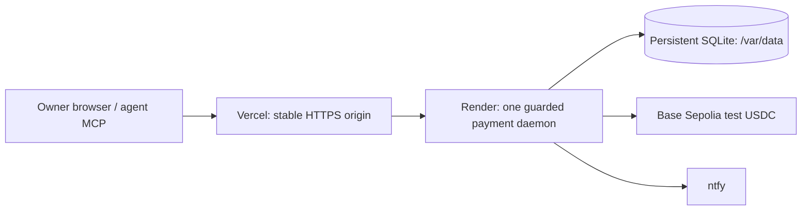

# Vercel gateway and persistent payment backend

The selected default is now the [free Cloudflare deployment](deployment-free.md). This document retains the optional **paid** Render variant. No Render service is created by building or testing the repository.

The public dashboard/API/approval URLs live on Vercel. A Node function forwards only known Railgate routes to the configured HTTPS `*.onrender.com` backend. The Render service owns the wallet, continuous worker and SQLite database on a persistent disk. The gateway has no wallet key, owner token, database or worker; it forwards the caller's existing authentication to the backend. The root redirects to `/dashboard`.



The project remains test-money-only. All previous policy, approval, quote, routing and idempotency gates apply. HTTP redirects to another upstream host are refused; authorization stays on the configured backend. Gateway responses are never cached. POST timeouts instruct clients to retry the **same** idempotency key.

## Account setup

1. In Vercel, import `faizan896/railgate`, branch `main`, with the root directory at the repository root. The checked-in `vercel.json` selects the Node gateway, builds with `pnpm build`, and rewrites routes to `api/index.ts`. Select Node 24 if the project asks for a version. Record the **actual production HTTPS origin** Vercel assigns; do not assume a project-name URL is available.
2. Authorize the repository in Render and create a Blueprint using `render.yaml`. The blueprint uses a **paid Starter service and a 1 GB persistent disk**. Review Render's current pricing before creating it. One disk-backed backend/signing wallet must have one active daemon. Do not substitute a free ephemeral filesystem for this disk.
3. The gateway initially returns 503 until `RAILGATE_BACKEND_ORIGIN` points to the deployed backend. This is an incomplete connection, not a working payment service.

Provider reference examples: [Render's Node example](https://github.com/render-examples/express-hello-world/blob/main/render.yaml) and [Render's persistent SQLite example](https://github.com/render-examples/strapi-sqlite/blob/master/render.yaml) verify the service/env/disk configuration patterns. The official [Blueprint schema](https://render.com/schema/render.yaml.json), [Vercel configuration schema](https://openapi.vercel.sh/vercel.json) and installed official Vercel Node builder are the deployment references. Local tests do not prove the remote account/project is deployed.

## Preserve the existing payment history

Never start the existing wallet against a fresh database. Otherwise a retry can lose its old idempotency record and pay again. Existing tokens, wallet keys and all historical IDs/fingerprints/hashes must move with the database.

When both hosting accounts/projects are ready:

1. Stop the old local daemon/tunnel that owns this wallet. Do not kill unrelated processes. Keep it stopped throughout cutover. Confirm there are no unresolved payments; the exporter refuses pending/reserved/unknown outcomes.
2. From the owner checkout run:

   ```sh
   pnpm export:hosting --confirm-daemon-stopped
   ```

   This creates a verified SQLite backup in ignored `data/hosting/database.sqlite` and an ignored **mode 0600** `.env.render`. Nothing secret is printed. The private environment file contains the original wallet/owner/agent/ntfy settings and a compressed, checksummed database snapshot. Do not commit it, upload it to Vercel, send it in chat, or include it in build context. Larger databases need a private volume-level restore instead of the 32 MiB decoded / 96 KiB encoded bootstrap limits.
3. Import `.env.render` securely into the **Render backend's** environment settings. Also set `PUBLIC_BASE_URL` to the actual Vercel production origin. Render supplies `PORT`; the checked-in settings bind `HOST=0.0.0.0` and use `/var/data/railgate.sqlite`. Optional demo return/ntfy/Wise values remain backend-only.
4. The initial environment sets `RAILGATE_DATABASE_BOOTSTRAP=1`. Startup verifies/decompresses the snapshot and atomically creates only a **missing** database. Existing state is never overwritten. Bootstrap mode forces **read-only HTTP and a paused worker**, so no payment or approval/return action can execute during verification.
5. Verify the backend `/health` reports chain 84532, `test_money_only: true`, `read_only: true`. Verify historical payment count/IDs/hashes and the authenticated dashboard against the private backup. Use only read operations during this stage.
6. Remove `RAILGATE_DATABASE_BOOTSTRAP`, `RAILGATE_DATABASE_SNAPSHOT` and `RAILGATE_DATABASE_SHA256` from the Render environment, then redeploy using the **same persistent disk**. Confirm `/health` now reports `read_only: false`. A missing database with bootstrap disabled causes startup to fail; an old snapshot cannot silently reset payment history.
7. Set Vercel's `RAILGATE_BACKEND_ORIGIN` to the backend's actual HTTPS `*.onrender.com` origin and redeploy Vercel. Do not put any wallet/owner/signing/ntfy credentials on Vercel. The production URL must be reachable by the owner's phone and ntfy action callbacks; Vercel account-level deployment protection must allow those requests to reach Railgate's own Basic/HMAC protection.
8. Verify anonymous `/health`, anonymous dashboard 401, owner dashboard 200 and agent limits/status reads through the new connection. The owner Basic username/password and limited agent token remain the original values. Do not issue a new live payment just to verify deployment. Keep the former daemon stopped.
9. Point clients at the stable origin: `pnpm setup:mcp --api-url https://actual-production-origin`, then restart/reload Codex/Cursor/Claude. Test `get_my_limits` and `list_payments`; no spend is necessary to verify MCP connectivity.

On a separate client computer, create its private `.env.mcp` from `examples/mcp-client.env.example` and supply only the limited agent token and production origin. Run `pnpm build` and `pnpm setup:mcp` there. The owner's wallet/approval/ntfy `.env` stays on the backend and is never copied to an agent machine.

Keep the persistent database backed up after cutover. Restoring an old initial snapshot after later payments would lose financial/idempotency state; bootstrap is a one-time read-only operation, not an automatic disaster-recovery reset. Do not replace a missing volume or signing wallet state with empty defaults.

## Local validation

```sh
pnpm lint
pnpm typecheck
pnpm test
pnpm build
docker build -t railgate-hosting:test .
node scripts/smoke-container.mjs railgate-hosting:test
```

The container smoke uses a disposable test volume and explicit mock execution/notification interfaces. It checks unprivileged runtime, SQLite across container restart, no private environment files in the image, guarded mainnet refusal, protected dashboard, read-only writes, and refusal to start against missing payment state. It makes no external payment or notification calls.

In a network that supplies its own trusted proxy CA, use the existing public CA only as a BuildKit secret:

```sh
docker build --secret id=railgate_build_ca,src="$NODE_EXTRA_CA_CERTS" -t railgate-hosting:test .
```

The optional secret is used only during dependency installation and is absent from the runtime image. TLS/package checks stay enabled. A normal Render/GitHub build uses standard system trust and needs no custom CA.

## Current deployment status

GitHub publication and local Codex MCP registration/read-only tool calls have been verified. All **141 tests**, lint, typecheck, build and the offline overspend demo passed on Node 24. The backend image builds locally and its container smoke passed, including SQLite across container restart. Live Vercel/Render account authorization, initial state transfer, provider deployment and public verification remain separate required steps. The old daemon/data are retained until those projects are ready; no live cutover or new payment was performed while access remained unavailable.
